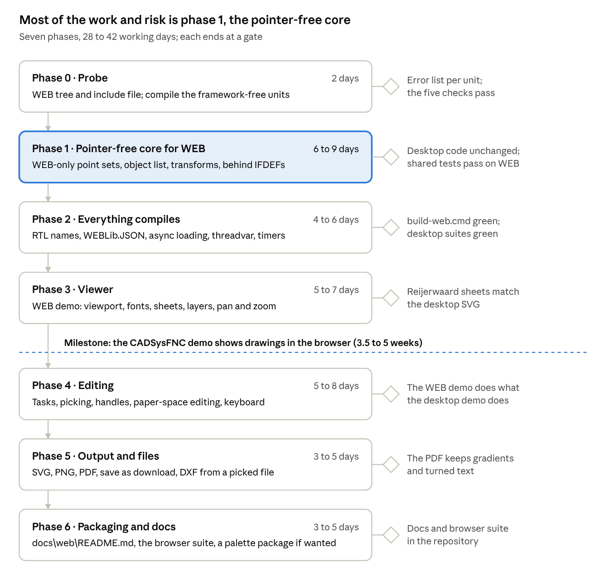

# CADSysFNC on TMS WEB Core: analysis and implementation plan

**Status:** Plan, decisions taken 2026-11-05 (see [decision 0005](../decisions/0005-webcore-support.md)). Nothing built yet.
**Date:** 2026-11-05, measured against CADSysFNC `f3620e4`.

## Summary

CADSysFNC can run in the browser on TMS WEB Core in about **5.5 to 8.5 weeks** for the chosen target: viewing,
editing and output, shown first in the CADSysFNC demo. The libraries it needs are on this machine: TMS WEB Core 3.0.5
(pas2js 3.3.1) and FNC Core 4.5.0.7, whose WEB build includes the graphics, the PDF library and a JSON reader and
writer.

The biggest job is the core data. The core data structures in `FNCCADSys4` keep their memory by hand (`GetMem`,
`FreeMem`, typed pointers), and JavaScript has no such memory. WEB gets its own versions of those classes, built on
dynamic arrays and classes, while the desktop keeps its code as it is.

- **Approach:** one master for all four frameworks and a fourth generated tree (`Generated\WEB`, units
  `WEBLib.FNCC*`). The classes that keep memory by hand get a second, WEB-only implementation behind
  `{$IFDEF CADSYS_WEB}`, so the desktop core stays exactly as it is.
- **First step:** a two-day probe that compiles the framework-free units with pas2js and checks five things the plan
  relies on (phase 0).
- **Lasting cost:** from then on every change to the shared units must also compile with pas2js. A WEB compile check
  in the build scripts keeps that honest.

## Goal and scope

A WEB Core application gets the same drawing component as the desktop: a `TFNCCADViewport2D` on a form that shows a
drawing and its sheets, and lets the user edit them.

| Area | In the browser | How |
| --- | --- | --- |
| Model and sheets: draw, pan, zoom, layers, named views | Yes | FNC Core's WEB graphics on an HTML canvas |
| Editing: tasks, picking, handles, paper space | Yes (phase 4) | The task engine has no platform code |
| Open a drawing | Yes, asynchronously | From a URL, a string or a file the user picks |
| Save a drawing | Yes | As a download, or in the browser's storage |
| SVG and PNG | Yes | SVG as text; PNG from the canvas |
| PDF | Yes, to be confirmed | FNC Core's WEB PDF library; the 600 dpi fixes come along |
| Printing | Through the browser | Print the PDF or the SVG |
| DXF import | Yes | From a file the user picks, parsed as text |
| EMF, the Windows clipboard, GDI printing | No | Windows only |
| Legacy `.CS2` files | No, at first | Binary reader; little use in a browser |

The desktop libraries keep every feature. Nothing in the VCL, FMX or LCL trees is removed to make room for WEB.

## What is there today

Everything the port needs from TMS is installed; nothing in CADSysFNC targets WEB yet. Checked on the laptop against
CADSysFNC `f3620e4`.

- **TMS WEB Core 3.0.5** with pas2js 3.3.1 and the command-line `TMSWebCompiler.exe`, so a WEB compile check can run
  from a `.cmd` like the other build scripts. Its RTL has `TList`, `TStringList`, `TMemoryStream`, `TBytesStream`,
  generics, `WEBLib.JSON` (a `TJSONObject` / `TJSONArray` API close to `System.JSON`), `WEBLib.RegularExpressions`,
  `NetEncoding` and a browser unit-test framework (`WEBLib.UnitTesting`).
- **FNC Core 4.5.0.7** ships a WEB build (`packages\web`, 84 units) and its `WEBLib.*` sources: `TTMSFNCGraphics`,
  `TTMSFNCCustomControl`, the PDF library and PDF engine, `TTMSFNCPrinters`, JSON reader and writer.
- **The generator** (`Tools\gen-units.ps1`) already makes three trees from `Sources` by one replace: `VCL.FNCC` to
  `FMX.FNCC` or `LCLFNCC`. A fourth tree is one more entry, plus a `WEBLib.FNCCADSys.inc` that defines `CADSYS_WEB`.
- **The LCL branch helps.** pas2js names its RTL units without the `System.` prefix (`Classes`, `SysUtils`, `Types`,
  `Math`), as FPC does, and the 53 `CADSYS_LCL` branches already spell them that way. Most can become "LCL or WEB".
- **Windows-only units stay out:** `FNCCS4GDI`, `FNCCS4GraphicsVCL`, `FNCCS4ExportVCL` and `FNCCS4PrintFMX`, as the
  generator already leaves `FNCCS4GDI` out of the LCL tree.

## What pas2js cannot compile

About 51,000 of the 55,600 lines go to the browser, and the hard part sits in one unit: `FNCCADSys4` holds 243 of the
369 pointer uses and all 45 `GetMem`/`FreeMem` calls. Counts are from a scan of `Sources` with comments left out, so
treat them as sizes, not exact numbers.

| Unit | Lines | Pointers, manual memory | JSON uses | Other work | To WEB |
| --- | --- | --- | --- | --- | --- |
| `FNCCADSys4` | 26,216 | 243 pointer uses; `GetMem` 17, `FreeMem` 28, `Move` 4 | 323, of which 11 streaming | one `threadvar`; `System.SyncObjs`; `Vcl.ExtCtrls` timer | Yes |
| `FNCCS4Shapes` | 9,187 | 1 | 316 | 9 `AnsiString` (text shapes); `NetEncoding` | Yes |
| `FNCCS4Tasks` | 3,866 | 0 | 0 | none found | Yes |
| `FNCCS4DXFModule` | 2,289 | 0 | 2 | `System.Variants`; reads files | Yes, from text |
| `FNCCS4PDF` | 1,734 | 14 | 0 | `RegularExpressions`, `Rtti`; the link update parses bytes | Yes, phase 5 |
| `FNCCS4Graphics` | 1,617 | 11 (the `Pts: Pointer; Count` API) | 0 | streams for images | Yes |
| `FNCCS4SVG` | 1,129 | 10 | 0 | streams | Yes |
| `FNCCS4GraphicsFNC` | 1,078 | 13 | 0 | a VCL-only GDI branch for turned text | Yes, own branch |
| `FNCCS4Print` | 1,051 | 0 | 40 | page setup files | Yes |
| `FNCCS4JSON` | 805 | 0 | 220, of which 10 streaming | `Rtti`, `Generics.Collections` | Yes |
| `FNCCS4BaseTypes` | 695 | 8 | 0 | uses `FNCCS4GraphicsVCL` for system colours | Yes, after decoupling |
| `FNCCS4Preview` | 453 | 0 | 0 | none found | Yes |
| `FNCCS4Image` | 419 | 0 | 0 | PNG through streams | Yes, PNG from the canvas |
| `FNCCS4Paper`, `FNCCS4Views`, `FNCCadSysRegister` | 687 | 0 | 29 | none found | Yes |
| `FNCCS4Legacy` | 1,051 | 0 | 0 | binary `.CS2` reader | Not at first |
| `FNCCS4GDI`, `GraphicsVCL`, `ExportVCL`, `PrintFMX` | 3,297 | 89 | 0 | Windows API, VCL, FMX printer | No |

What each kind of finding means:

- **Manual memory** has no meaning in JavaScript. The point sets (`TPointsSet2D/3D.fPoints`), the object list's
  blocks (`PObjBlock`), the list's ID array (`fListMemory`), the model transforms (`fModelTransform`) and the clipping
  buffers in `Draw2DSubSet` all use `GetMem`. On WEB they become dynamic arrays, classes and plain record fields.
- **The `Pointer` + `Count` drawing API** (`Polyline`, `Polygon`, `PVectPoints2D`) gets open-array versions on WEB.
- **JSON tree code** moves across almost as it is: `WEBLib.JSON` has `TJSONObject`, `TJSONArray`, `AddPair`,
  `GetValue`, `Count`, `Items` and `ToJSON`. A few calls (`Remove`, `AsInt64`, `Null`) need a helper. The streaming
  reader and writer (21 uses) stay desktop-only; the browser's own JSON parser is fast enough.
- **`threadvar`, `SyncObjs`, `Rtti`, `Variants`:** the browser runs one thread, so a plain variable and no lock do;
  enum names come from `TypInfo`.
- **Files:** `LoadFromFile` and `SaveToFile` do not exist in a browser. Loading becomes asynchronous (URL, string,
  file picker) and saving a download.

## Design

One master in `Sources`, one more generated tree, and every WEB difference written as a `{$IFDEF CADSYS_WEB}` branch
where it bites, as the FMX and LCL differences already are.

1. **A fourth tree.** `gen-units.ps1` gets `'WEB' = @(, @('VCL.FNCC', 'WEBLib.FNCC'))` and a `WEBLib.FNCCADSys.inc`
   that defines `CADSYS_WEB`. The unit list leaves out the four Windows-only units and the legacy reader. The units
   then match FNC's own naming (`WEBLib.TMSFNCGraphics` beside `WEBLib.FNCCADSys4`).
2. **Short RTL names, shared with LCL.** The include files define a second symbol, `CADSYS_PLAINRTL`, for LCL and
   WEB. The 53 `{$IFDEF CADSYS_LCL}` uses branches that only rename RTL units switch to it. Branches that are really
   about Lazarus keep `CADSYS_LCL`.
3. **Pointer-free core for WEB; the desktop core stays as it is.** The few classes that keep memory by hand get a
   second, WEB-only implementation behind the same public API, chosen by `{$IFDEF CADSYS_WEB}` in the one master. The
   desktop trees compile exactly the code they compile today.
    - `TPointsSet2D/3D`: on WEB a dynamic array (`TArray<TPoint2D>`) behind the same methods; on the desktop the
      `GetMem` buffer as now.
    - `TGraphicObjList`: on WEB its blocks are a small class and the ID array a `TArray<TGraphicObject>`.
    - Model and saved transforms: on WEB record fields with an `fHasTransform` flag.
    - The `Draw2DSubSet` buffers: on WEB local dynamic arrays.
    - `PointsReference` and the `Pointer` + `Count` drawing API stay desktop-only. WEB gets open-array versions, and
      the about 190 places in the shared units that hand a pointer on get a WEB branch.
    - The cost: about 1,500 to 2,500 lines exist twice, every fix in those classes is made in both, and their tests
      run on both sides.
4. **JSON.** `FNCCS4JSON` stays the one place that knows the JSON library. On WEB its uses clause names
   `WEBLib.JSON`, and its helpers cover the few calls that differ. `SaveToJSONWriter` and `LoadFromJSONReader` stay
   desktop-only; `SaveToJSONString` / `LoadFromJSONString` work everywhere.
5. **Asynchronous loading.** New `CADLoadFromURL(ACAD, AURL, AOnDone)` and a file-picker helper on WEB. The default
   vector fonts (`RomanC` and friends) go into a generated resource unit, so they are there before the first paint
   instead of fetched.
6. **The back buffer.** The viewport draws into an offscreen `TBitmap` and copies it to the screen. On WEB that is
   FNC's bitmap canvas. If it turns out slow or incomplete in the probe, WEB first draws straight to the screen
   without the pan/zoom cache.
7. **Colours.** `TCADColor` stays `$AARRGGBB` in a `Cardinal`. pas2js keeps unsigned 32-bit arithmetic, but every
   `shr`/`and` on colours gets a test in the browser suite (phase 0 confirms it).
8. **`BaseTypes` decoupled.** It uses `FNCCS4GraphicsVCL` only so the system-colour resolver registers itself. That
   becomes a registration hook called by each backend, so `BaseTypes` names no backend.
9. **No design-time package at first.** WEB applications create the components in code. A palette package for the
   WEB Core form designer is phase 6, only if wanted.

## Implementation plan

Seven phases, 28 to 42 working days in all; each ends at a gate that is checked before the next one starts.

Every phase is WEB work; the desktop code is only touched where a uses clause or an IFDEF seam needs it. The tasks per
phase:

1. **Phase 0, probe (2 days).** Add the WEB tree and `WEBLib.FNCCADSys.inc`; compile `FNCCS4Graphics`, `Paper`,
   `BaseTypes` and `JSON` with `TMSWebCompiler.exe`. Check five things in a small WEB page: unsigned colour
   arithmetic, an array of 100,000 `TPoint2D` records (speed and copy semantics), FNC's offscreen bitmap canvas,
   `WEBLib.JSON` on a drawing saved by the desktop, and FNC's WEB PDF library writing a page. Go or no-go.
2. **Phase 1, pointer-free core for WEB (6 to 9 days).** In `Sources`, under `{$IFDEF CADSYS_WEB}`: point sets as
   dynamic arrays; object-list blocks as a class and the ID array as `TArray`; transforms as fields with a flag; the
   `Draw2DSubSet` buffers; open-array drawing calls and the WEB branches at the pointer call sites. The desktop code
   is not touched, so its suites and its speed must come out unchanged. The shared tests for these classes are
   written so the browser suite can run them too.
3. **Phase 2, everything compiles (4 to 6 days).** `CADSYS_PLAINRTL` for the 53 RTL-name branches; the
   `WEBLib.TMSFNC*` uses branches; `WEBLib.JSON` behind `FNCCS4JSON`; streaming JSON, `threadvar`, `SyncObjs`, `Rtti`
   and `Variants` handled; `TTimer` from `WEBLib.ExtCtrls`; the `BaseTypes` hook; `build-web.cmd` and
   `CADSysWEBCheck`.
4. **Phase 3, viewer (5 to 7 days).** The CADSysFNC CAD2D demo, rebuilt for WEB in `Demos\CAD2D\WEB`: a form with the
   viewport and rulers; the compiled-in font unit; `CADLoadFromURL` and loading from a string; sheets, viewports and
   layers; the back buffer, or direct drawing. The browser suite starts here.
5. **Phase 4, editing (5 to 8 days).** The task engine, picking with the pick aperture, viewport handles, paper-space
   editing, keyboard shortcuts; touch only if asked for.
6. **Phase 5, output and files (3 to 5 days).** SVG and PNG as downloads; PDF through FNC's WEB PDF library with the
   gradient and turned-text overrides; save as a JSON download or in the browser's storage; DXF from a picked file.
7. **Phase 6, packaging and docs (3 to 5 days).** `docs\web\README.md` (what works, what does not, the async load
   API), the WEB lines in `docs\migrating.md` and the README, and a palette package for the WEB Core designer if
   wanted.

## Testing and build

The desktop suites remain the main guard: every shared change must keep them green (at `7b15de7`, the last run
measured for this plan: 716 found, 709 passed, 7 ignored; FNC 67/67), and `build.cmd` stays the gate. WEB adds the
checks below.

- **`Tools\build-web.cmd`:** runs `gen-units.cmd`, then `TMSWebCompiler.exe` on `Test\CADSysWEBCheck`, a WEB project
  that uses every WEB unit and runs nothing, the counterpart of `CADSysFMXCheck`. Log in `Tools\logs\build-web.log`.
  It joins `build.cmd` as a step.
- **A browser suite with `WEBLib.UnitTesting`:** the parts that behave differently in JavaScript. That means colour
  arithmetic, point sets, the object list, JSON round trips against a fixture written by the desktop, and hit testing.
  It is opened in Edge or Chrome and reads green or red; a headless run can come later.
- **The same picture two ways:** the WEB demo draws the Reijerwaard sheets and the CAD2D test drawing. Its SVG export
  is compared with the desktop's SVG of the same drawing, as the PDF and sheet work was signed off before.
- **Speed:** the drawing-speed drawing (100,000 lines) is timed in the WEB demo in phase 3. The desktop numbers are
  run once to confirm they did not move (FMX repaint at zoom-all was 209 ms).
- **Masterplanner:** its CI builds against the local CADSysFNC, so every WEB change is also checked for leaving the
  desktop alone.

## Risks and open questions

The two real risks are speed and the lasting cost; the rest is the probe's job to settle.

| Risk | Effect | What limits it |
| --- | --- | --- |
| Two implementations of the core classes drift apart | A fix lands on the desktop but not on WEB, or the reverse | Same public API; the same tests run in both suites; both halves of each class next to each other in one file; later, fold the desktop onto the WEB version if it proves as fast |
| JavaScript too slow for large drawings | 100,000-line drawings sluggish in the browser | The sub-pixel dot and cached pan already in the library; measure in phase 3 |
| pas2js behaves differently (record copies, unsigned arithmetic) | Bugs only seen in the browser | The browser suite on those exact areas |
| FNC WEB lacks something the viewport uses (offscreen canvas, text metrics before a font loads) | Workarounds in the viewport | Checked in the probe; draw without the cache first if needed |
| Every shared change must compile with pas2js | Slower changes, a fourth build to run | `build-web.cmd` in `build.cmd`; the rule written into the docs |
| The ID-index work in `TGraphicObjList` (drawing-speed plan) | Two changes to one class | Do the WEB version after it lands, or fold the two together |

## Decisions (2026-11-05)

Recorded in [decision 0005](../decisions/0005-webcore-support.md).

1. **Target:** all phases, viewing and editing.
2. **Unit prefix:** `WEBLib.FNCC`, matching FNC's WEB units.
3. **Pointer-free core:** separate, WEB-only implementations behind `{$IFDEF CADSYS_WEB}` in the one master; the
   desktop core is not touched.
4. **Fonts:** the default vector fonts compiled into a unit.
5. **First user:** the CADSysFNC demo.
